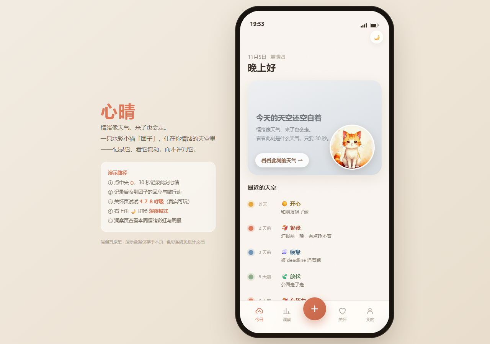
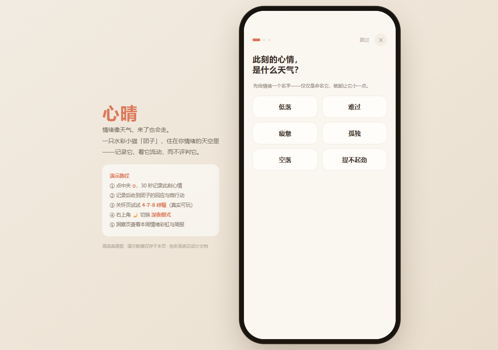
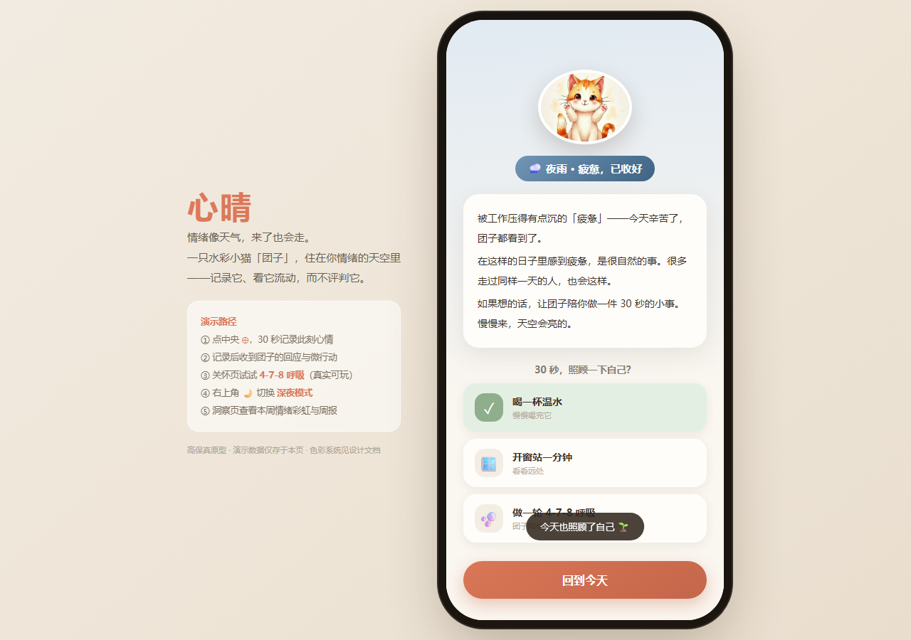
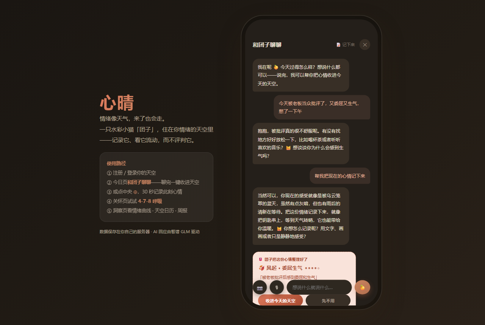
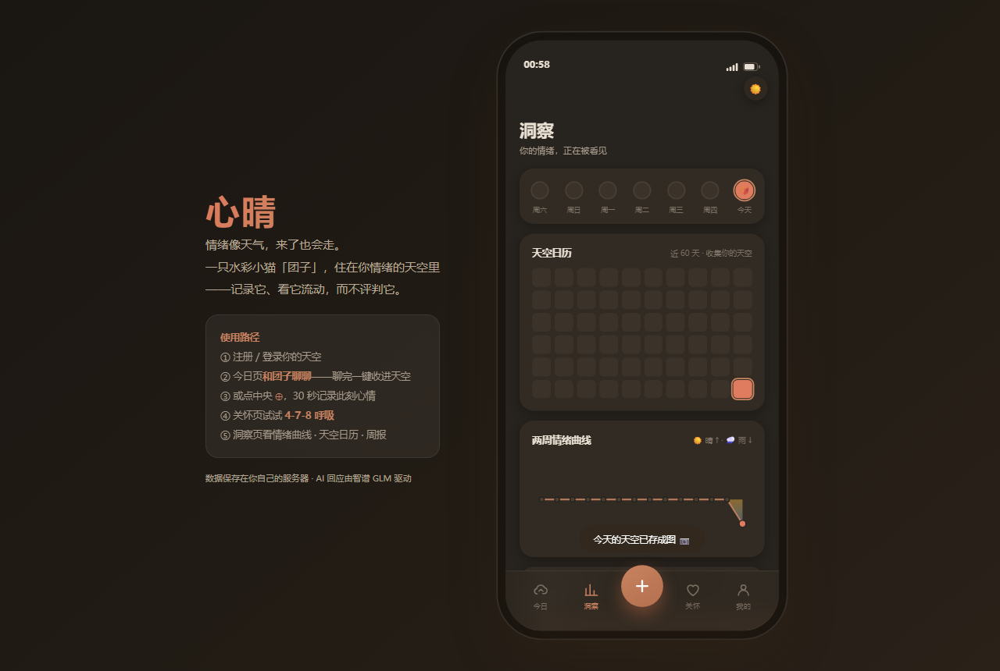
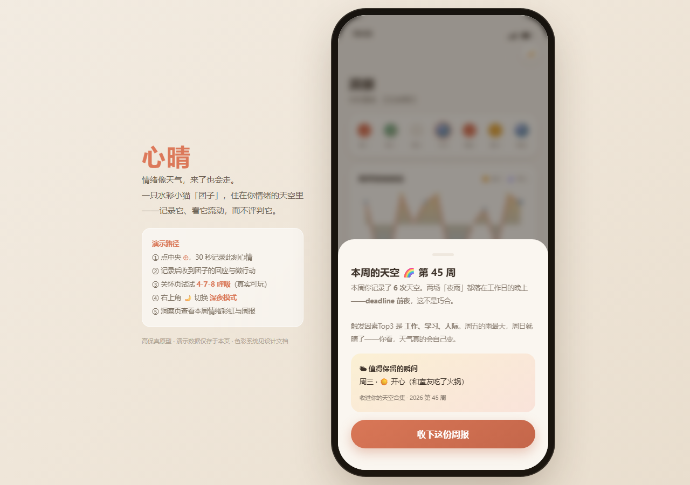
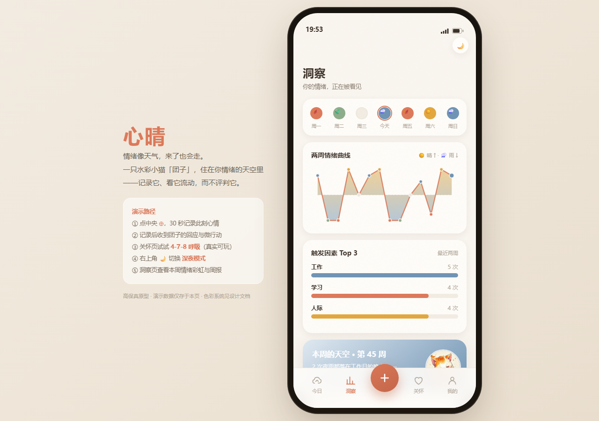
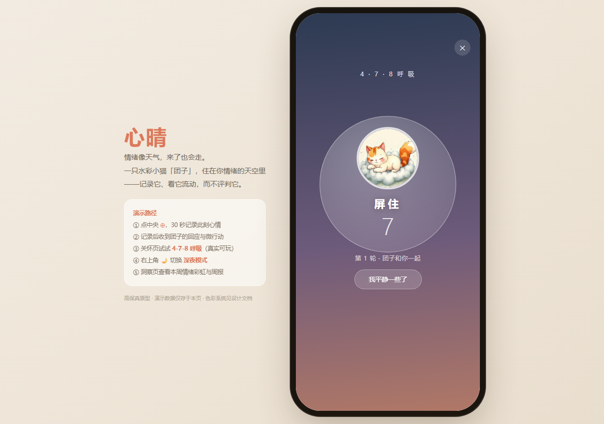
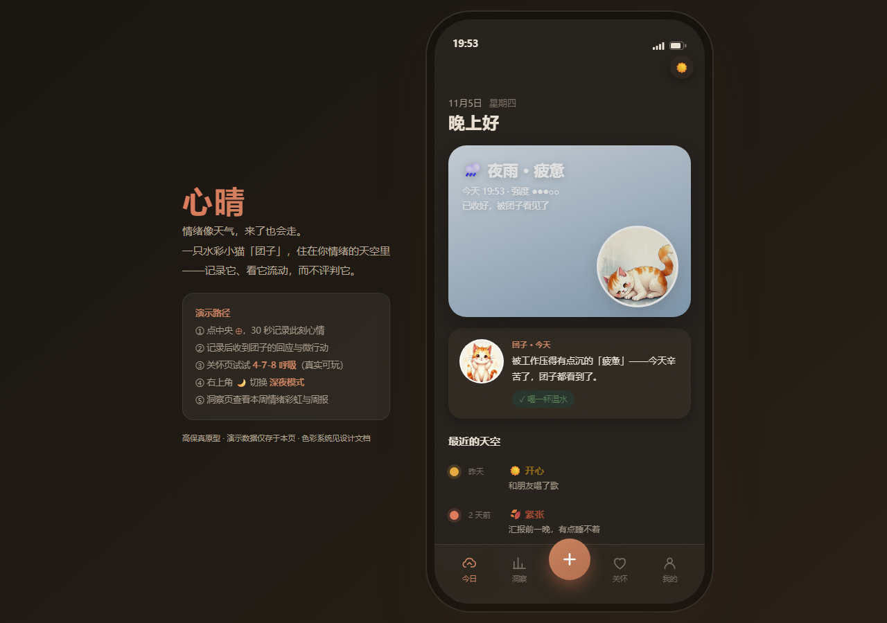

# 心晴 MoodCare 🌤️

> 情绪像天气，来了也会走。

一款情绪日记与自我关怀 App：用 30 秒记录此刻心情，AI 小猫「团子」给出三段式温柔回应，长期沉淀为情绪洞察与周报。背景是安静的天空，情绪是流动的天气。

**在线体验**：https://meituan.typexx.work （支持注册，可添加到主屏幕作为 PWA 使用）

## 界面预览

| 今日·情绪天空 | 30 秒记录 | 团子的回应 |
|---|---|---|
|  |  |  |

| 聊天自动生成心情卡片 | 洞察·天空日历 | AI 周报 |
|---|---|---|
|  |  |  |

| 洞察统计 | 呼吸练习 | 夜间模式（22:00 自动） |
|---|---|---|
|  |  |  |

## 核心功能

- **30 秒记录流程**：四象限情绪（风起/日晴/夜雨/微风）→ 情绪词与触发因素（支持自定义）→ 可选一句倾诉
- **AI 自我关怀回应**：基于 Neff 自我关怀理论工程化的三段式回应（承认→共通人性→善待自己），由小猫「团子」送达，并附 3 选 1 微行动（行为激活）
- **和团子聊聊**：自由对话支持文字 / 🎙语音识别 / 📷图片（glm-4v-flash 视觉理解）；AI 自动从聊天中提取情绪，内联生成「心情卡片」提案，确认后一键入库
- **洞察页**：情绪分布、触发因素排行、60 天「天空日历」热力图、AI 周报
- **关怀页**：呼吸练习、安抚卡片、危机词安全网（识别高风险词时展示求助热线）
- **分享图**：今日天空卡一键生成 900×1200 分享图片
- **PWA**：manifest + 图标，可添加到主屏幕；夜间模式 22:00 自动切换暖色

## 设计理念

**色彩哲学「背景静，情绪动」**：暖米白 `#FAF6F0` 环境层保持安静，四族情绪色随记录流动——valence 决定色相（风起红 / 日晴黄 / 夜雨蓝 / 微风绿），arousal 决定饱和度。今日页的天空卡随情绪动态渐变。

详见 [docs/02-产品结构与UI色彩设计.md](docs/02-产品结构与UI色彩设计.md)，调研背景见 [docs/01-调研报告-痛点需求与创新点.md](docs/01-调研报告-痛点需求与创新点.md)。

## 技术栈

- **后端**：Python + FastAPI + SQLite（容器卷持久化），JWT 鉴权，scrypt 密码哈希
- **AI**：智谱 GLM（`glm-4-flash` 文本 / `glm-4v-flash` 视觉）
- **前端**：原生 JS 单页应用（零构建），与高保真原型视觉一致
- **部署**：Docker Compose + Caddy 反向代理，时区统一 Asia/Shanghai

## 快速开始

```bash
pip install -r requirements.txt

# 必需：智谱 API Key（ https://open.bigmodel.cn ）
export ZHIPU_API_KEY=your_key

# 可选
export MOODCARE_SECRET=change_me   # JWT 签名密钥，默认 dev-secret-change-me
export MOODCARE_DB=/path/to/db     # SQLite 路径，默认 app/moodcare.db

python -m uvicorn app.main:app --port 8000
# 打开 http://localhost:8000 ，API 文档在 /api/docs
```

服务器部署：`deploy/` 内含 Dockerfile 与 docker-compose.yml（接入已有 Caddy 边缘网络的模式，按需修改外部网络名）。

## 项目结构

```
├── app/               # FastAPI 后端 + 原生 JS 前端（app/static/）
│   ├── api.py         # 全部 REST 路由（鉴权/记录/聊天/统计/周报）
│   ├── llm.py         # GLM 调用：三段式回应、视觉回应、情绪提取
│   ├── db.py          # SQLite 初始化与访问
│   └── security.py    # JWT + scrypt
├── prototype/         # 高保真单文件原型（设计定稿）
├── docs/              # 调研报告、产品设计文档、精选截图
├── deploy/            # Dockerfile + docker-compose.yml
├── e2e*.cjs           # Playwright E2E（4 轮迭代各一份，对应 v1.0~v1.3）
├── gen_all_cats.py    # 水彩猫素材 AI 生成脚本（CogView-4）
└── assets/            # 生成的猫状态图素材
```

## E2E 测试

每轮迭代附带一份 Playwright E2E，覆盖当轮新功能全流程：

```bash
node e2e.cjs    # v1.0 注册→记录→AI 回应→洞察→周报→关怀
node e2e2.cjs   # v1.1 自定义情绪词/日记/聊天语音图片
node e2e3.cjs   # v1.2 聊天心情提案闭环→天空日历
node e2e4.cjs   # v1.3 悬浮输入条与滚动行为
```

## 迭代记录

- **v1.0**：调研 → 产品设计 → 高保真原型 → 全栈上线
- **v1.1**：桌面端视口适配、情绪词/触发因素自定义、写日记、聊天支持语音与图片
- **v1.2**：聊天自动提取情绪生成心情卡片提案、天空日历、分享图、PWA、修改密码、时区修复
- **v1.3**：聊天输入条改固定悬浮胶囊，滚动体验修复
